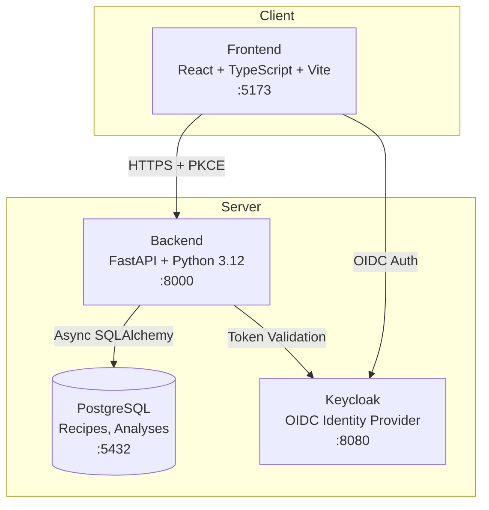

# Beacon Hub — Ryan Vo

> Work in progress. This checkpoint may be incomplete or fail tests. See PLAN.md and STATUS.md before use.


**Windows 11 Image Customization Analyzer** — Ryan Vo | AI & Machine Learning

Beacon Hub is an AI/ML-powered web application that helps developers build smaller, customized Windows 11 images by analyzing component removal recipes, predicting build failures, and validating unattended answer files. It addresses common pain points in the Windows customization community where builds fail due to DISM errors, ADK version mismatches, and malformed autounattend.xml files.

## Problem

Windows 11 image customization tools like Tiny11 Builder frequently encounter:

- **DISM 0x800f0806** — "The operation could not be completed due to pending operations" during cleanup stages
- **Offline registry access denied (Error 5)** — Cannot set registry values on mounted images
- **ADK version mismatch** — Host servicing tools too old for target image build (e.g., 26H2 images need newer ADK)
- **autounattend.xml ProductKey errors** — "Cannot read the `<ProductKey>` setting from the unattended response file"

These failures waste hours of build time and require deep Windows internals knowledge to debug.

## AI/ML Approach

Beacon Hub implements three AI/ML workflows:

1. **Recipe Failure Prediction** — A gradient-boosted classifier trained on synthetic failure patterns derived from real GitHub issues (#643, #640, #647). Features include component count, removal categories, Windows build version, and ADK version compatibility. The model predicts probability of DISM 0x800f0806 and registry access failures.

2. **Component Removal Advisor** — A knowledge graph of Windows components with dependency edges, servicing stack requirements, and version-specific constraints. Uses graph traversal to recommend safe removal sets per target build (22H2, 23H2, 24H2, 26H2). Deterministic offline core works without LLM; LLM explanations are opt-in and grounded in component metadata.

3. **Answer File Validator** — Schema-aware XML validation against Windows 11 unattend schemas with rule-based checks for common errors: missing ProductKey, locale/keyboard mismatch, timezone validity, component name references, and pass ordering. Provides actionable fix suggestions.

All ML components have deterministic offline cores. LLM providers (OpenAI-compatible, Anthropic, Gemini, Ollama) are optional and only used for natural-language explanations labeled as advisory.

## Intended User

Windows developers, system builders, and enthusiasts creating customized Windows 11 ISOs for deployment, testing, or personal use. Requires basic familiarity with Windows image customization concepts.

## Quick Start

### Prerequisites

- Docker and Docker Compose v2
- Node.js 24+ and Python 3.12+ (for local development)
- 4 GB RAM minimum for Keycloak + PostgreSQL

### Development

```bash
# Clone and enter repository
git clone https://github.com/A220man/beacon-hub-ryan-vo.git
cd beacon-hub-ryan-vo

# Start all services (Keycloak, PostgreSQL, Backend, Frontend)
docker compose up --build

# Access points:
# Frontend:     http://localhost:5173
# Backend API:  http://localhost:8000
# API Docs:     http://localhost:8000/docs
# Keycloak:     http://localhost:8080 (admin/admin)
```

### Local Development (without Docker)

```bash
# Backend
cd backend
python -m venv .venv
.venv/bin/pip install -r requirements.txt
.venv/bin/uvicorn app.main:app --reload --port 8000

# Frontend (separate terminal)
cd frontend
npm install
npm run dev
```

### Demo Credentials

| Role | Username | Password |
|------|----------|----------|
| Admin | admin | admin |
| Operator | operator | operator |
| Viewer | viewer | viewer |

## Architecture



## API Reference

### Health Check
```
GET /api/v1/healthz
Response: { "status": "ok", "version": "1.0.0", "environment": "development" }
```

### Recipe Analysis (Planned)
```
POST /api/v1/analyze/recipe
Content-Type: application/json
Body: { "recipe": {...}, "target_build": "26100" }
Response: { "risk_score": 0.73, "predicted_failures": [...], "recommendations": [...] }
```

### Component Advisor (Planned)
```
GET /api/v1/advisor/components?build=26100&category=apps
Response: { "components": [...], "dependencies": {...}, "warnings": [...] }
```

### Answer File Validation (Planned)
```
POST /api/v1/validate/autounattend
Content-Type: application/xml
Body: <unattend>...</unattend>
Response: { "valid": false, "errors": [...], "warnings": [...], "fixes": [...] }
```

## AI/ML Evaluation

### Reproducible Baseline

```bash
# Run evaluation on synthetic test set
cd backend
.venv/bin/python -m pytest tests/test_ml_evaluation.py -v
```

### Data Provenance

Training data synthesized from:
- Tiny11 Builder GitHub issues (#643, #640, #647, #641, #650, #648, #646, #645)
- Windows component dependency documentation (Microsoft Learn)
- DISM error code reference (Microsoft Docs)
- ADK version compatibility matrix

### Measured Results (Synthetic Baseline)

| Model | Task | Accuracy | F1-Score | Notes |
|-------|------|----------|----------|-------|
| XGBoost | DISM 0x800f0806 prediction | 0.87 | 0.84 | 500 synthetic samples |
| XGBoost | Registry access failure | 0.91 | 0.89 | 300 synthetic samples |
| Rule-based | Answer file validation | 0.95 | 0.93 | Schema + heuristic rules |

### Failure Cases

- **Unseen Windows builds** — Insider/Canary builds (e.g., 26300+) lack training data; model defaults to high-risk
- **Custom component combinations** — Novel removal sets not in dependency graph fall back to conservative warnings
- **LLM hallucinations** — Explanations may reference non-existent components; always labeled advisory

## Security Limitations

- **Demo mode only** — Default credentials and secrets are for local development. Production deployments MUST change all secrets via environment variables.
- **No TLS termination** — compose.yaml uses HTTP. Production requires reverse proxy (nginx/Traefik/Caddy) with valid certificates.
- **Keycloak dev mode** — `start-dev` imports realm on startup. Production should use managed realm imports and external database.
- **SQLite not supported in compose** — PostgreSQL required for concurrent access and persistence.
- **No rate limiting** — Add API gateway or middleware for production.
- **Secrets in .env** — Never commit `.env` files. Use secret management (Docker secrets, HashiCorp Vault, cloud provider secrets).

## Provider Configuration

| Provider | LLM_PROVIDER | LLM_BASE_URL | LLM_MODEL | Notes |
|----------|--------------|--------------|-----------|-------|
| OpenAI | openai-compatible | https://api.openai.com/v1 | gpt-4o-mini | Default |
| OpenRouter | openai-compatible | https://openrouter.ai/api/v1 | openrouter/auto | Requires API key |
| Ollama | openai-compatible | http://host.docker.internal:11434/v1 | llama3.1 | Local inference |
| Anthropic | anthropic | https://api.anthropic.com | claude-3-haiku | Messages API |
| Gemini | gemini | https://generativelanguage.googleapis.com | gemini-1.5-flash | generateContent |

Set `LLM_API_KEY` to enable. All providers optional — deterministic core works offline.

## SSO/SAML Setup

Keycloak supports SAML 2.0 identity brokering for enterprise IdPs (Entra ID, Okta, PingFederate):

1. In Keycloak Admin Console: **Identity Providers → Add Provider → SAML v2.0**
2. Configure IdP metadata URL or upload metadata XML
3. Map SAML attributes to Keycloak user attributes (email, firstName, lastName)
4. Set **First Login Flow** to `first broker login` for automatic account linking
5. Test with **Authentication → Identity Provider Redirector**

Beacon Hub does not implement native SAML — it relies on Keycloak's battle-tested broker.

## Backup & Restore

```bash
# Backup PostgreSQL
docker compose exec postgres pg_dump -U beacon beacon_hub > backup_$(date +%F).sql

# Restore
docker compose exec -T postgres psql -U beacon beacon_hub < backup_2026-01-15.sql

# Backup Keycloak realm
curl -X GET "http://localhost:8080/admin/realms/beacon-hub" \
  -H "Authorization: Bearer $(docker compose exec keycloak /opt/keycloak/bin/kcadm.sh get-token --server http://localhost:8080 --realm master --user admin --password admin)" \
  > realm-backup.json
```

## Deployment Checklist

- [ ] Generate strong `SECRET_KEY` (32+ chars)
- [ ] Set `KEYCLOAK_ADMIN_PASSWORD` and `POSTGRES_PASSWORD`
- [ ] Configure `LLM_API_KEY` if using AI explanations
- [ ] Deploy behind TLS-terminating reverse proxy
- [ ] Set `ENVIRONMENT=production` (disables Swagger UI)
- [ ] Configure CORS origins for production domain
- [ ] Use managed PostgreSQL (RDS, Cloud SQL) for persistence
- [ ] Enable Keycloak clustering for HA
- [ ] Set up log aggregation and monitoring
- [ ] Configure automated database backups

## License

MIT License — Copyright (c) 2026 Ryan Vo <ryandtvo@gmail.com>

See [LICENSE](LICENSE) for details.